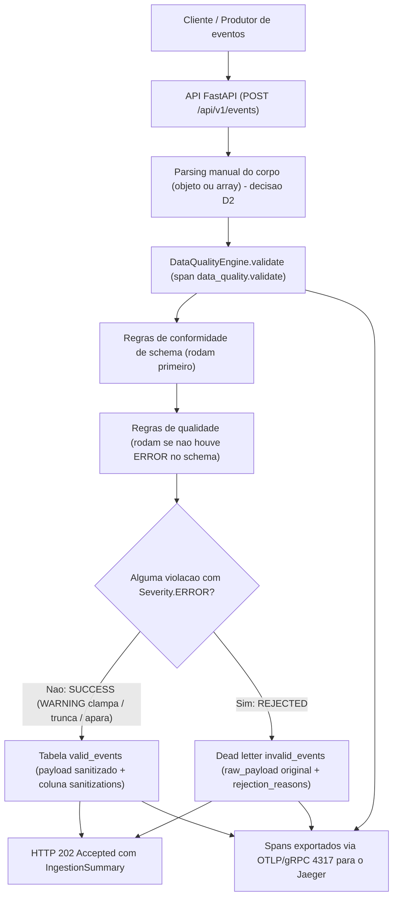
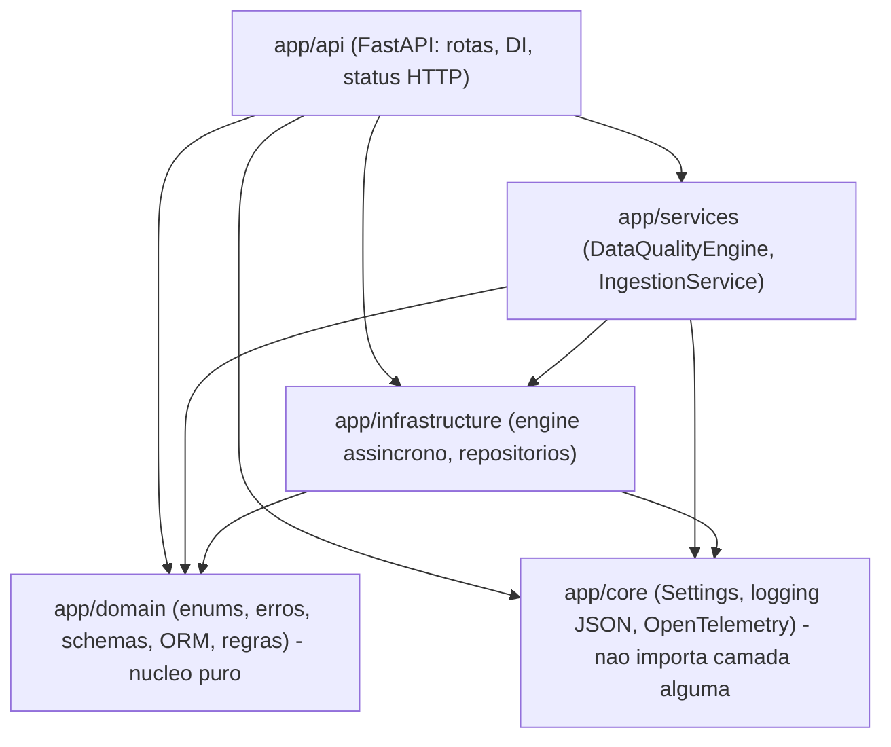

# Real-time Event Ingestion & Data Quality Engine

[](https://github.com/ptkguedes/data-quality-engine/actions/workflows/ci.yml)

Serviço de ingestão de eventos em tempo real escrito em **Python 3.12 + FastAPI**, com um
motor de **Data Quality** componível, persistência assíncrona em **PostgreSQL 15** e
rastreamento distribuído via **OpenTelemetry** exportado para **Jaeger**.

O contrato é simples: todo evento recebido é *adjudicado*. Eventos aprovados — com ou sem
sanitização — vão para a tabela `valid_events`; eventos reprovados vão para o dead letter
`invalid_events` com a razão exata da rejeição. **Nenhum evento é descartado em silêncio.**

| | |
|---|---|
| Endpoint de ingestão | `POST /api/v1/events` (objeto JSON **ou** array de objetos) |
| Código de sucesso | `202 Accepted`, sempre — inclusive para um lote 100% rejeitado |
| Documentação interativa | `http://localhost:8000/docs` |
| Jaeger UI | `http://localhost:16686` |

---

## Arquitetura

O projeto segue Clean Architecture com quatro camadas e uma **direção de dependência
estrita**: `api → services → domain ← infrastructure`. O `domain` é o núcleo puro e não
importa nada das outras camadas.

| Camada | Pasta | Responsabilidade | Restrição |
|---|---|---|---|
| API | `app/api/` | Rotas, parsing do corpo, injeção de dependência, mapeamento de status HTTP | É a **única** camada que usa as primitivas HTTP do `fastapi` (`APIRouter`, `Request`, `Depends`, `HTTPException`) |
| Services | `app/services/` | `DataQualityEngine` (catálogo de regras) e `IngestionService` (validar → persistir) | Não importa `fastapi` |
| Domain | `app/domain/` | Enums, erros, schemas Pydantic v2, modelos ORM e os objetos de valor das regras | Não importa `app.api`, `app.services` nem `app.infrastructure` |
| Infrastructure | `app/infrastructure/` | Engine/sessão assíncrona, `create_all`, repositórios | Depende só de `app.domain` e `app.core` |
| Core | `app/core/` | `Settings` (pydantic-settings), logging JSON, OpenTelemetry | Transversal: não importa nenhuma outra camada da `app`. `telemetry.py` recebe a instância da app apenas para instrumentá-la (`FastAPIInstrumentor`) |

### Estrutura de pastas

```
.
├── app/
│   ├── main.py                      # fábrica da app, lifespan, handlers de exceção
│   ├── api/
│   │   ├── deps.py                  # sessão de banco + DI dos serviços
│   │   └── v1/
│   │       ├── router.py            # agrega os routers da v1
│   │       ├── events.py            # POST /api/v1/events
│   │       └── health.py            # GET /health, GET /health/ready
│   ├── core/
│   │   ├── config.py                # Settings: todos os limites do motor
│   │   ├── logging.py               # JsonFormatter com trace_id/span_id
│   │   └── telemetry.py             # TracerProvider + instrumentadores
│   ├── domain/
│   │   ├── enums.py                 # EventStatus, Severity, RejectionReason
│   │   ├── errors.py                # DomainError, PersistenceError
│   │   ├── models.py                # ORM: ValidEvent, InvalidEvent
│   │   ├── rules.py                 # Violation, EvaluationContext, QualityRule
│   │   └── schemas.py               # RawEventPayload, IngestionSummary, ...
│   ├── infrastructure/
│   │   ├── database.py              # engine assíncrono, create_all, ping
│   │   └── repositories.py          # ValidEventRepository, InvalidEventRepository
│   └── services/
│       ├── data_quality.py          # motor + todas as classes de regra
│       └── ingestion.py             # roteamento válido / dead letter
├── tests/                           # suíte pytest rodando em aiosqlite em memória
├── Dockerfile
├── docker-compose.yml
├── requirements.txt
├── requirements-dev.txt
├── pytest.ini
├── .env.example
└── README.md
```

### Fluxo de ingestão



### Dependências entre camadas



---

## Como executar

### Com Docker (caminho recomendado)

```bash
docker compose up --build
```

Três contêineres sobem: a API, o PostgreSQL 15 e o Jaeger all-in-one. A API só inicia
depois do healthcheck `pg_isready` do banco passar (`depends_on` com
`condition: service_healthy`), e ela própria tem healthcheck batendo em `/health` pela
stdlib do Python (a imagem `python:3.12-slim` não traz `curl`), então
`docker compose ps` mostra a saúde dos dois serviços.

A senha do banco é parametrizada: `POSTGRES_PASSWORD` vale `dq` por padrão e é interpolada
tanto no serviço `postgres` quanto no `DATABASE_URL` da API. Para subir sem a senha padrão:

```bash
POSTGRES_PASSWORD=uma-senha-sua docker compose up --build
```

| Serviço | URL |
|---|---|
| Swagger UI | http://localhost:8000/docs |
| ReDoc | http://localhost:8000/redoc |
| OpenAPI JSON | http://localhost:8000/openapi.json |
| Liveness | http://localhost:8000/health |
| Readiness | http://localhost:8000/health/ready |
| Jaeger UI | http://localhost:16686 |

**Não existe passo de migração.** As tabelas `valid_events` e `invalid_events` são criadas
no startup pelo `Base.metadata.create_all` dentro do lifespan da aplicação (decisão D5), de
modo que `docker compose up` entrega o schema pronto sem nenhuma intervenção manual.

Para derrubar tudo, incluindo o volume de dados:

```bash
docker compose down -v
```

### Local, sem Docker

O caminho do projeto contém um espaço, então o virtualenv vive **fora** dele (um venv
interno geraria shebangs com espaço e quebraria os console scripts `uvicorn`/`pytest`). Por
isso o Python é sempre invocado como `<venv>/bin/python -m <módulo>`:

```bash
python3 -m venv /home/patrickengdev/.venvs/dq
/home/patrickengdev/.venvs/dq/bin/pip install -r requirements.txt -r requirements-dev.txt

# Sem Jaeger por perto, desligue o SDK de telemetria:
cd "/home/patrickengdev/data quality"
OTEL_SDK_DISABLED=true DATABASE_URL=postgresql+asyncpg://dq:dq@localhost:5432/dq \
  /home/patrickengdev/.venvs/dq/bin/python -m uvicorn app.main:app --reload
```

Suíte de testes (roda inteira em SQLite em memória, sem precisar de PostgreSQL nem Docker):

```bash
cd "/home/patrickengdev/data quality"
/home/patrickengdev/.venvs/dq/bin/python -m pytest -q
```

---

## Exemplos de uso

Os exemplos abaixo usam `$(date -u +%Y-%m-%dT%H:%M:%SZ)` no campo `timestamp` de propósito:
o motor rejeita eventos mais antigos que `RETENTION_WINDOW_DAYS` (30 dias) com
`TIMESTAMP_TOO_OLD`, então um timestamp fixo colado daqui a um mês falharia. As respostas
mostradas foram capturadas da aplicação real.

### 1. Evento válido → `SUCCESS`

```bash
curl -s -X POST http://localhost:8000/api/v1/events \
  -H "Content-Type: application/json" \
  -d "{
    \"event_id\": \"7f1f1a3e-6a5a-4d6f-9b1e-2c0a9d4e5f60\",
    \"event_type\": \"sensor.reading\",
    \"source\": \"gateway-01\",
    \"timestamp\": \"$(date -u +%Y-%m-%dT%H:%M:%SZ)\",
    \"payload\": {\"temperature\": 21.5, \"humidity\": 48.0, \"value\": 100}
  }"
```

`HTTP 202 Accepted`

```json
{
  "total": 1,
  "accepted": 1,
  "rejected": 0,
  "results": [
    {
      "event_id": "7f1f1a3e-6a5a-4d6f-9b1e-2c0a9d4e5f60",
      "status": "SUCCESS",
      "violations": [],
      "sanitizations": []
    }
  ]
}
```

> Use um UUID de verdade no `event_id`. Um identificador fora do formato UUID é aceito, mas
> gera uma sanitização `INVALID_EVENT_ID` com severidade `WARNING`.

### 2. Rejeitado pela conformidade de schema (`source` ausente)

```bash
curl -s -X POST http://localhost:8000/api/v1/events \
  -H "Content-Type: application/json" \
  -d "{
    \"event_id\": \"1b9d6bcd-bbfd-4b2d-9b5d-ab8dfbbd4bed\",
    \"event_type\": \"sensor.reading\",
    \"timestamp\": \"$(date -u +%Y-%m-%dT%H:%M:%SZ)\",
    \"payload\": {\"temperature\": 21.5}
  }"
```

`HTTP 202 Accepted` — a rejeição é um resultado de negócio, não um erro de transporte
(decisão D4). O evento foi gravado em `invalid_events`.

```json
{
  "total": 1,
  "accepted": 0,
  "rejected": 1,
  "results": [
    {
      "event_id": "1b9d6bcd-bbfd-4b2d-9b5d-ab8dfbbd4bed",
      "status": "REJECTED",
      "violations": [
        {
          "code": "MISSING_REQUIRED_FIELD",
          "field": "source",
          "message": "Campos obrigatorios ausentes ou nulos: source.",
          "severity": "ERROR"
        }
      ],
      "sanitizations": []
    }
  ]
}
```

### 3. Sanitizado por uma regra de qualidade (`temperature: 150` → `60.0`)

```bash
curl -s -X POST http://localhost:8000/api/v1/events \
  -H "Content-Type: application/json" \
  -d "{
    \"event_id\": \"3f2504e0-4f89-11d3-9a0c-0305e82c3301\",
    \"event_type\": \"sensor.reading\",
    \"source\": \"gateway-01\",
    \"timestamp\": \"$(date -u +%Y-%m-%dT%H:%M:%SZ)\",
    \"payload\": {\"temperature\": 150, \"humidity\": 48.0}
  }"
```

`HTTP 202 Accepted` — status `SUCCESS`, com a sanitização registrada. O valor persistido em
`valid_events.payload` é `60.0` (clampado em `TEMPERATURE_MAX`) e a alteração fica na coluna
`valid_events.sanitizations`.

```json
{
  "total": 1,
  "accepted": 1,
  "rejected": 0,
  "results": [
    {
      "event_id": "3f2504e0-4f89-11d3-9a0c-0305e82c3301",
      "status": "SUCCESS",
      "violations": [],
      "sanitizations": [
        {
          "code": "TEMPERATURE_OUT_OF_RANGE",
          "field": "payload.temperature",
          "message": "temperature fora da faixa [-90.0, 60.0]; clampado.",
          "severity": "WARNING"
        }
      ]
    }
  ]
}
```

### 4. Rejeitado por uma regra de qualidade (`value: -1`)

```bash
curl -s -X POST http://localhost:8000/api/v1/events \
  -H "Content-Type: application/json" \
  -d "{
    \"event_id\": \"9c5b94b1-35ad-49bb-b118-8e8fc24abf80\",
    \"event_type\": \"billing.metric\",
    \"source\": \"gateway-02\",
    \"timestamp\": \"$(date -u +%Y-%m-%dT%H:%M:%SZ)\",
    \"payload\": {\"value\": -1}
  }"
```

`HTTP 202 Accepted`

```json
{
  "total": 1,
  "accepted": 0,
  "rejected": 1,
  "results": [
    {
      "event_id": "9c5b94b1-35ad-49bb-b118-8e8fc24abf80",
      "status": "REJECTED",
      "violations": [
        {
          "code": "NEGATIVE_VALUE",
          "field": "payload.value",
          "message": "value deve ser maior ou igual a 0.0.",
          "severity": "ERROR"
        }
      ],
      "sanitizations": []
    }
  ]
}
```

### 5. Lote: um array JSON no mesmo endpoint

Não existe `/batch`: o mesmo endpoint aceita um array e um lote é simplesmente
`len(items) > 1` (decisão D1). A ordem de `results` espelha a ordem do array enviado.

```bash
curl -s -X POST http://localhost:8000/api/v1/events \
  -H "Content-Type: application/json" \
  -d "[
    {
      \"event_id\": \"8f1f1a3e-6a5a-4d6f-9b1e-2c0a9d4e5f60\",
      \"event_type\": \"sensor.reading\",
      \"source\": \"gateway-01\",
      \"timestamp\": \"$(date -u +%Y-%m-%dT%H:%M:%SZ)\",
      \"payload\": {\"temperature\": 21.5, \"humidity\": 48.0, \"value\": 100}
    },
    {
      \"event_id\": \"1b9d6bcd-bbfd-4b2d-9b5d-ab8dfbbd4bed\",
      \"event_type\": \"sensor.reading\",
      \"timestamp\": \"$(date -u +%Y-%m-%dT%H:%M:%SZ)\",
      \"payload\": {\"temperature\": 21.5}
    }
  ]"
```

`HTTP 202 Accepted`

```json
{
  "total": 2,
  "accepted": 1,
  "rejected": 1,
  "results": [
    {
      "event_id": "8f1f1a3e-6a5a-4d6f-9b1e-2c0a9d4e5f60",
      "status": "SUCCESS",
      "violations": [],
      "sanitizations": []
    },
    {
      "event_id": "1b9d6bcd-bbfd-4b2d-9b5d-ab8dfbbd4bed",
      "status": "REJECTED",
      "violations": [
        {
          "code": "MISSING_REQUIRED_FIELD",
          "field": "source",
          "message": "Campos obrigatorios ausentes ou nulos: source.",
          "severity": "ERROR"
        }
      ],
      "sanitizations": []
    }
  ]
}
```

### Health checks

```bash
curl -s http://localhost:8000/health        # 200 {"status":"ok","database":null}
curl -s http://localhost:8000/health/ready  # 200 {"status":"ok","database":"ok"}
```

`/health/ready` executa um `SELECT 1` e responde `503` com
`{"detail": "Banco de dados indisponivel.", "trace_id": ...}` quando o banco não responde.
Os dois endpoints também estão montados em `/api/v1/health` e `/api/v1/health/ready`.

### Códigos de status

| Status | Quando |
|---|---|
| `202 Accepted` | Todo corpo que foi lido como objeto ou array JSON, inclusive um lote inteiramente rejeitado |
| `400 Bad Request` | Apenas erros de transporte: corpo que não é JSON decodificável, ou JSON escalar no topo (string, número, booleano, `null`) |
| `413 Request Entity Too Large` | O array enviado tem mais de `MAX_BATCH_SIZE` elementos; nada é adjudicado nem gravado |
| `503 Service Unavailable` | Falha de persistência (`PersistenceError`), com `trace_id` no corpo |
| `500 Internal Server Error` | Exceção não tratada, com `trace_id` no corpo |

Um payload inválido **de negócio nunca** devolve `422`: ele é aceito com `202` e registrado
em `invalid_events` (decisão D2). Um elemento de array que não é objeto JSON também não é
`400` — ele vai para o dead letter com o código `UNPARSEABLE_ENVELOPE`.

---

## Catálogo de regras

Conformidade de schema (executa primeiro; se qualquer `ERROR` disparar aqui, as regras de
qualidade são puladas):

| Código | Severidade | Verificação |
|---|---|---|
| `MISSING_REQUIRED_FIELD` | ERROR | `event_id`, `event_type`, `source` e `timestamp` presentes e não nulos |
| `INVALID_EVENT_ID` | ERROR / WARNING | String vazia ou em branco é ERROR; string fora do formato UUID é aceita e normalizada (WARNING) |
| `INVALID_TIMESTAMP` | ERROR / WARNING | Não parseável como ISO-8601 é ERROR; sem fuso horário é assumido UTC (WARNING) |
| `PAYLOAD_NOT_OBJECT` | ERROR / WARNING | `payload` ausente é sanitizado para `{}` (WARNING); de outro tipo é ERROR |
| `ENVELOPE_STRING_TOO_LONG` | WARNING → trunca | `event_id`, `event_type` e `source` acima de `MAX_ENVELOPE_STRING_LENGTH`, que acompanha a largura `String(128)` das colunas — o limite é adjudicado pelo motor, nunca pelo banco |
| `UNKNOWN_FIELD` | ERROR / WARNING | Chaves fora do envelope: ERROR em `STRICT_MODE=true`, senão movidas para `payload._extra` (WARNING) |
| `UNPARSEABLE_ENVELOPE` | ERROR | O elemento não é um envelope interpretável (ex.: não é objeto, ou `event_type` não é string) |

Regras de qualidade (todas executam e todas as violações são acumuladas):

| Código | Severidade | Verificação |
|---|---|---|
| `NON_NUMERIC_METRIC` | ERROR | `temperature`/`humidity`/`value` presentes mas não convertíveis para número |
| `TEMPERATURE_OUT_OF_RANGE` | WARNING → clampa | `payload.temperature` em `[TEMPERATURE_MIN, TEMPERATURE_MAX]` |
| `HUMIDITY_OUT_OF_RANGE` | WARNING → clampa | `payload.humidity` em `[HUMIDITY_MIN, HUMIDITY_MAX]` |
| `NEGATIVE_VALUE` | ERROR | `payload.value` deve ser `>= VALUE_MIN` (padrão `0.0`) |
| `STRING_TOO_LONG` | WARNING → trunca | Strings no **primeiro nível** do payload acima de `MAX_STRING_LENGTH`; strings aninhadas dentro de objetos ou listas do payload não são inspecionadas |
| `UNTRIMMED_STRING` | WARNING → apara | Espaços nas pontas de `event_type`/`source` |
| `TIMESTAMP_IN_FUTURE` | ERROR | Mais de `FUTURE_TIMESTAMP_TOLERANCE_SECONDS` à frente de agora |
| `TIMESTAMP_TOO_OLD` | ERROR | Mais antigo que `RETENTION_WINDOW_DAYS` |
| `DUPLICATE_EVENT_ID` | ERROR | `event_id` já visto na janela de deduplicação em memória (veja a semântica de retentativa na decisão D10) |

A **severidade é que decide o roteamento** (decisão D7): `WARNING` muta a cópia de trabalho
e o evento continua válido; `ERROR` manda o evento para o dead letter. Nenhuma regra decide
seu próprio destino.

---

## Inspecionando o banco

Eventos aprovados, com o payload já sanitizado e o registro do que foi alterado:

```bash
docker compose exec postgres psql -U dq -d dq -c "SELECT id, event_id, event_type, source, event_timestamp, payload, sanitizations, ingested_at, trace_id FROM valid_events ORDER BY id DESC LIMIT 10;"
```

Dead letter / auditoria, com o corpo **original** intocado e a razão da rejeição:

```bash
docker compose exec postgres psql -U dq -d dq -c "SELECT id, event_id, raw_payload, rejection_reasons, rejected_at, trace_id FROM invalid_events ORDER BY id DESC LIMIT 10;"
```

Contagem por código de rejeição, útil para enxergar o produtor problemático:

```bash
docker compose exec postgres psql -U dq -d dq -c "SELECT r->>'code' AS code, COUNT(*) FROM invalid_events, jsonb_array_elements(rejection_reasons) AS r GROUP BY 1 ORDER BY 2 DESC;"
```

Só os eventos que precisaram de sanitização:

```bash
docker compose exec postgres psql -U dq -d dq -c "SELECT event_id, payload->'temperature' AS temperature, sanitizations FROM valid_events WHERE sanitizations IS NOT NULL ORDER BY id DESC LIMIT 10;"
```

As colunas `payload`, `sanitizations`, `raw_payload` e `rejection_reasons` são `JSONB` no
PostgreSQL. Observação: `original` e `applied` (o valor antes e depois de uma sanitização)
são gravados nessas colunas, mas **não** aparecem no corpo da resposta HTTP — o
`ViolationOut` da API expõe só `code`, `field`, `message` e `severity`.

---

## Variáveis de ambiente

Uma linha por campo de `Settings` em `app/core/config.py`. O nome da variável é o campo em
`UPPER_SNAKE_CASE`; os valores também podem vir de um arquivo `.env` (veja `.env.example`).

| Variável | Descrição | Padrão |
|---|---|---|
| `APP_NAME` | Nome da aplicação, usado no título do OpenAPI | `Real-time Event Ingestion & Data Quality Engine` |
| `APP_VERSION` | Versão exposta no OpenAPI e no recurso OTel | `1.0.0` |
| `ENVIRONMENT` | Ambiente lógico, exportado como `deployment.environment` | `local` |
| `DATABASE_URL` | DSN assíncrono do SQLAlchemy | `postgresql+asyncpg://dq:dq@postgres:5432/dq` |
| `DB_POOL_SIZE` | Tamanho do pool de conexões | `5` |
| `DB_MAX_OVERFLOW` | Conexões extras permitidas além do pool | `10` |
| `OTEL_SDK_DISABLED` | `true` não instala nenhum provider: telemetria totalmente desligada | `false` |
| `OTEL_EXPORTER_OTLP_ENDPOINT` | Collector OTLP/gRPC de destino | `http://jaeger:4317` |
| `OTEL_SERVICE_NAME` | `service.name` nos traces, usado para filtrar no Jaeger | `data-quality-engine` |
| `OTEL_METRICS_ENABLED` | Instala o `MeterProvider` e exporta métricas por OTLP. Desligado porque o Jaeger não ingere métricas | `false` |
| `STRICT_MODE` | `true` transforma chave desconhecida no envelope em `ERROR` em vez de sanitização | `false` |
| `FUTURE_TIMESTAMP_TOLERANCE_SECONDS` | Folga aceita para timestamps no futuro | `300` |
| `RETENTION_WINDOW_DAYS` | Idade máxima aceita de um evento, em dias | `30` |
| `TEMPERATURE_MIN` | Piso do clamp de `payload.temperature` | `-90.0` |
| `TEMPERATURE_MAX` | Teto do clamp de `payload.temperature` | `60.0` |
| `HUMIDITY_MIN` | Piso do clamp de `payload.humidity` | `0.0` |
| `HUMIDITY_MAX` | Teto do clamp de `payload.humidity` | `100.0` |
| `VALUE_MIN` | Piso aceito para `payload.value` (abaixo disso é `NEGATIVE_VALUE`) | `0.0` |
| `MAX_STRING_LENGTH` | Tamanho máximo de uma string do primeiro nível do payload antes do truncamento | `512` |
| `MAX_ENVELOPE_STRING_LENGTH` | Tamanho máximo de `event_id`/`event_type`/`source`; deve acompanhar o `String(128)` das colunas | `128` |
| `DEDUP_WINDOW_SIZE` | Quantidade de `event_id`s mantidos na LRU de deduplicação | `10000` |
| `MAX_BATCH_SIZE` | Máximo de elementos aceitos em um array JSON por requisição (acima disso, `413`) | `1000` |
| `LOG_LEVEL` | Nível do logging estruturado em JSON | `INFO` |

Todos os limites usados pelo motor moram aqui: não existe número mágico inline nas regras.

Duas variáveis são do `docker-compose.yml`, não de `Settings`:

| Variável | Descrição | Padrão |
|---|---|---|
| `POSTGRES_PASSWORD` | Senha do PostgreSQL, interpolada também no `DATABASE_URL` da API | `dq` |

Ela existe para que a stack não suba com uma senha conhecida fora do ambiente local:
exporte `POSTGRES_PASSWORD` (ou coloque no `.env`) antes do `docker compose up`.

`MAX_BATCH_SIZE` limita a **quantidade de eventos** por requisição, não o número de bytes.
Em produção, combine com um limite de tamanho de corpo no proxy à frente da API — por
exemplo `client_max_body_size 1m` no nginx — para que um corpo gigante seja recusado antes
de chegar ao processo Python.

---

## Observabilidade

A instrumentação usa `FastAPIInstrumentor.instrument_app(app)` e
`SQLAlchemyInstrumentor().instrument(engine=engine.sync_engine)`, com um `TracerProvider`
que exporta por `BatchSpanProcessor` + OTLP/gRPC para o endpoint configurado.

Os dois instrumentadores rodam em momentos diferentes (decisão D19): o da aplicação na
**fábrica** (`create_app`), porque ele adiciona um middleware ASGI e o Starlette congela a
pilha de middlewares no primeiro `__call__` — que é justamente o evento de `lifespan`; o do
banco **no lifespan**, onde o engine existe. Com tudo no lugar, uma requisição rende um
único trace: o span de servidor `POST /api/v1/events` como raiz, `data_quality.validate` e
`ingestion.persist_*` como filhos, e os spans do SQLAlchemy (`connect`, `SELECT dq`,
`INSERT dq`) abaixo deles.

### Encontrando um trace no Jaeger

1. Abra http://localhost:16686.
2. Em **Service**, escolha o valor de `OTEL_SERVICE_NAME` — por padrão `data-quality-engine`.
3. Para ver só o que foi reprovado, filtre por tag `dq.status=REJECTED`.
4. Dentro do trace, procure os spans:

| Span | Origem | O que mostra |
|---|---|---|
| `data_quality.validate` | `app/services/data_quality.py` | A adjudicação de um evento; status do span `ERROR` quando rejeitado |
| `ingestion.persist_valid` | `app/services/ingestion.py` | A escrita em `valid_events` (atributos `db.table`, `event.id`) |
| `ingestion.persist_invalid` | `app/services/ingestion.py` | A escrita no dead letter `invalid_events` |

Atributos disponíveis em `data_quality.validate`:

| Atributo | Conteúdo |
|---|---|
| `dq.status` | `SUCCESS` ou `REJECTED` |
| `dq.violation_count` | Quantidade de violações `ERROR` |
| `dq.sanitization_count` | Quantidade de sanitizações `WARNING` |
| `dq.rules_evaluated` | Quantas regras efetivamente rodaram (revela o curto-circuito da decisão D9) |
| `dq.violation_codes` | Lista dos códigos de rejeição |
| `event.id` | `event_id` do evento, quando presente |
| `event.type` | `event_type` do evento, quando presente |

Quando um evento é reprovado, o span recebe também o **evento de span** `event.rejected`,
carregando `dq.violation_codes` — é o marcador para procurar na timeline.

Métricas instrumentadas: o contador `dq.events.processed` (atributo `dq.status`) e o
histograma `dq.validation.duration_ms`. **A exportação de métricas vem desligada**
(`OTEL_METRICS_ENABLED=false`): o Jaeger all-in-one ingere *traces* e responde
`UNIMPLEMENTED` ao serviço OTLP de métricas, de modo que ligá-la apontando para o Jaeger só
produziria um `ERROR` do exportador a cada intervalo, sem nenhuma métrica chegar a lugar
algum. Os instrumentos continuam sendo alimentados pelo motor; para coletá-las de verdade,
aponte `OTEL_EXPORTER_OTLP_ENDPOINT` para um collector que aceite métricas (um
`otel-collector`, por exemplo) e marque `OTEL_METRICS_ENABLED=true`.

Logs saem em JSON de uma linha, com `trace_id` e `span_id` do span corrente, o que permite
pular do log direto para o trace.

### Desligando ou degradando a telemetria

`OTEL_SDK_DISABLED=true` desliga tudo: nenhum provider é instalado (é assim que a suíte de
testes roda). E um collector inalcançável **não derruba requisição nenhuma**: toda a
configuração do SDK está dentro de um `try/except` que só registra um warning, e o
`BatchSpanProcessor` exporta fora da thread da requisição (decisão D15).

---

## Decisões de arquitetura

- **D1 — Um endpoint, payload união.** `POST /api/v1/events` aceita um objeto JSON ou um
  array de objetos. Não existe `/batch`: um contrato só, um ponto só de entrada para o
  motor, e o caso de lote é apenas `len(items) > 1`.
- **D2 — Parsing manual do corpo, sem modelo Pydantic de body.** A rota recebe `Request` e
  faz `await request.json()`. Um body declarado — ainda que permissivo — devolveria um `422`
  do próprio FastAPI para um payload inválido de negócio, e o evento **nunca chegaria** à
  tabela de auditoria. Os únicos `400` são de transporte.
- **D4 — `202 Accepted` sempre**, inclusive para um lote 100% rejeitado. A requisição foi
  ingerida e adjudicada com sucesso; o desfecho de cada evento está no corpo da resposta.
  Rejeição é resultado de negócio, não erro de transporte.
- **D5 — `create_all` no lifespan, sem Alembic.** O requisito é `docker compose up`
  funcionando com zero passos manuais; Alembic exigiria um entrypoint wrapper ou um init
  container. Em um deploy de produção de verdade a troca seria por Alembic, com migrações
  versionadas e revisáveis — aqui a simplicidade do boot venceu.
- **D6 — OTLP sobre gRPC na porta 4317.** É o padrão do SDK e da porta do próprio exporter
  gRPC, então o `OTEL_EXPORTER_OTLP_ENDPOINT` do compose e o código não podem divergir. O
  Jaeger all-in-one recebe OTLP nativamente, habilitado com `COLLECTOR_OTLP_ENABLED=true`.
- **D10 — Deduplicação em processo, não no banco.** Uma LRU limitada (`DEDUP_WINDOW_SIZE`)
  de `event_id`s recentes, por worker. É uma checagem barata de sanidade e **não** uma
  garantia distribuída: cada processo tem sua própria janela, e reiniciar o contêiner a
  zera. Um `SELECT` por evento dobraria as idas ao banco.
  A janela é **transacional**: um `event_id` aprovado entra como *reserva* e só é
  confirmado depois do commit. Daí a semântica de retentativa:
  - evento **rejeitado** não consome o `event_id` — a versão corrigida pode ser reenviada
    com o mesmo identificador;
  - lote que falhou na persistência (`503`) libera as reservas — a retentativa é aceita, e
    não volta como `DUPLICATE_EVENT_ID`;
  - dentro do mesmo lote (ou entre requisições concorrentes) a reserva já vale: a segunda
    cópia do mesmo `event_id` vai para o dead letter;
  - depois do commit o `event_id` está consumido enquanto permanecer na janela, então um
    reenvio idêntico é rejeitado como duplicado.
- **D19 — Instrumentação em dois momentos.** `configure_telemetry(app, settings)` roda na
  fábrica da aplicação, antes do startup, e `instrument_database(engine, settings)` roda no
  lifespan. Chamar o `FastAPIInstrumentor` de dentro do lifespan levanta *"Cannot add
  middleware after an application has started"*: o `try/except` da decisão D15 engole a
  exceção e o serviço fica sem span de servidor e sem spans de banco, com cada span
  explícito virando um trace órfão de um span só.
- **D7 — Severidade decide o roteamento.** `WARNING` sanitiza e mantém o evento válido;
  `ERROR` manda para o dead letter. A partição por severidade é do motor, não da regra.
- **D12/D13 — Falha de persistência vira `503`, nunca silêncio.** Os repositórios encapsulam
  `SQLAlchemyError` em `PersistenceError` e um handler devolve `503` com `trace_id`. Isso
  vale também para a escrita no dead letter: não "damos sucesso" a uma requisição cuja
  trilha de auditoria foi perdida. O `commit` final da requisição está sob o mesmo
  contrato — um flush que passa seguido de um commit que falha (conexão caindo no meio da
  requisição) é `503`, não `500`.

### Sobre a tag do Jaeger

A imagem está pinada em `jaegertracing/all-in-one:1.62.0`, com a versão de patch completa.
O alias curto `1.62` **não existe** no registry: o repositório publica `1.62.0`, e um
`docker compose up` apontando para `1.62` falharia no pull. A tag foi confirmada por
`docker compose up --build` de verdade: os três contêineres sobem, o Jaeger recebe OTLP na
4317 e os traces aparecem na UI.

Alternativas diretas, caso o pull falhe: `jaegertracing/all-in-one:1.57` (esse repositório
ainda publica o alias curto) ou `jaegertracing/all-in-one:latest`. A única exigência é uma
versão que aceite OTLP nativamente — 1.35 ou mais nova.

---

## Stack

| Componente | Versão |
|---|---|
| Python | 3.12 |
| FastAPI | 0.115.6 |
| Pydantic | 2.10.4 |
| SQLAlchemy | 2.0.36 (async) + asyncpg 0.30.0 |
| PostgreSQL | 15 (`postgres:15-alpine`) |
| OpenTelemetry | API/SDK 1.29.0, instrumentações 0.50b0 |
| Jaeger | all-in-one 1.62.0 |
| pytest | 8.3.4 + pytest-asyncio 0.25.0 |
